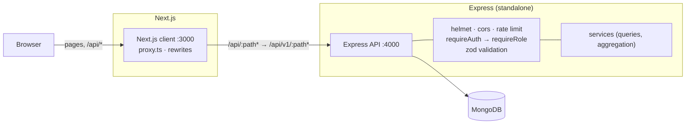

# Doctor Tracker — API (server)

> This is the **backend** repo. The Next.js frontend lives in [DoctorTracker-client](https://github.com/rejwanul313/DoctorTracker-client). This README documents the whole system.

Doctor Tracker is a secure admin portal for clinics that need one reliable place to manage their doctors and the patients assigned to them. Staff sign in with a session cookie, then create doctors, add or reassign patients, and search, filter and page through thousands of records instantly. A dashboard turns the same data into answers: how many doctors and patients there are, who is critical, how admissions and discharges are trending, and which doctors carry the most patients. It's a Next.js client talking to a standalone Express + MongoDB REST API, built around indexed queries, URL-driven state and a design system with light and dark themes.

| | |
|---|---|
| **Live app (Vercel)** | https://doctortracker-client.vercel.app |
| **Live API (Render)** | https://doctortracker-server-3hjh.onrender.com/api/v1 ([health check](https://doctortracker-server-3hjh.onrender.com/api/v1/health)) — free tier, first request after idle can take ~1 min |
| **Frontend repo** | https://github.com/rejwanul313/DoctorTracker-client |
| **Backend repo** | https://github.com/rejwanul313/DoctorTracker-server |
| **Admin (full access)** | `admin@doctortracker.app` / `Admin@12345` |
| **Staff (read-only)** | `staff@doctortracker.app` / `Staff@12345` |


---

## Contents

1. [Features](#features)
2. [Setup guide](#setup-guide)
3. [System architecture](#system-architecture)
4. [Technical decisions](#technical-decisions)
5. [Performance & scalability](#performance--scalability)
6. [API reference](#api-reference)
7. [Deployment](#deployment)
8. [Visual evidence](#visual-evidence)
9. [Project structure & scripts](#project-structure--scripts)

---

## Features

- **Authentication & authorization**: invite-only sign-in, bcrypt-hashed passwords, a JWT in an `httpOnly` / `SameSite=Lax` cookie (7 days), login rate limiting, route protection in the Next.js proxy *and* on every API route, and roles (`admin` can change data, `staff` is read-only).
- **Doctors**: create and edit (name, specialization, hospital, phone, email), search by name, email or phone, filter by specialization (tabs with live counts), hospital and joined date range, plus pagination and delete (patients become unassigned).
- **Doctor detail**: profile, patient counts by condition, the doctor's own patient list with search and pagination, **add a patient** under the doctor, and **remove** a patient from the list (optimistic, with **Undo**).
- **Patients**: list all patients, then search, filter by **condition** (tabs with counts), doctor (including *Unassigned*), gender and admitted date range, paginate, edit (including reassigning the doctor) and delete.
- **Dashboard**: total doctors, total patients, new admissions this month and critical patients, each with a month-over-month change and a sparkline; admissions vs discharges over 6, 12 or 24 months; patients by condition; the top doctors by patient count; and the latest admissions.
- **UX**: responsive from 390px phones to wide desktops, dark mode, ⌘K / Ctrl+K quick search, shareable URLs for every filter and page, skeleton loaders, empty and error states with retry, inline form validation (client and server), and toasts. Every control is keyboard- and screen-reader-accessible.

## Setup guide

**Prerequisites:** Node.js ≥ 20.9 (developed on 22), npm ≥ 10, and Docker (or any MongoDB 6+ instance, including Atlas).

The app is two repositories: **[DoctorTracker-server](https://github.com/rejwanul313/DoctorTracker-server)** (Express API) and **[DoctorTracker-client](https://github.com/rejwanul313/DoctorTracker-client)** (Next.js UI). Run both.

```bash
# 1. Clone both repos side by side
git clone https://github.com/rejwanul313/DoctorTracker-server.git
git clone https://github.com/rejwanul313/DoctorTracker-client.git

# 2. Start MongoDB (skip if you already run one on :27017 or use Atlas)
cd DoctorTracker-server
docker compose up -d

# 3. API → http://localhost:4000
npm install
cp .env.example .env          # set JWT_SECRET, e.g. `openssl rand -base64 48`
npm run seed                  # 2 users, 48 doctors, ~1,400 patients over 14 months + indexes
npm run dev

# 4. Client → http://localhost:3000 (second terminal)
cd ../DoctorTracker-client
npm install
cp .env.example .env.local    # use the SAME JWT_SECRET as the server
npm run dev
```

Sign in with the demo credentials above. The sign-in page shows and pre-fills them when `NEXT_PUBLIC_DEMO_EMAIL` is set.

### Environment variables

| File | Variable | Purpose |
|---|---|---|
| server `.env` | `MONGODB_URI` | MongoDB connection string |
| | `JWT_SECRET` | ≥ 32 chars; signs session tokens (shared with the client) |
| | `SESSION_TTL_DAYS`, `COOKIE_NAME` | Session lifetime (default 7) and cookie name |
| | `CLIENT_ORIGIN` | CORS allow-list (comma-separated) |
| | `TRUST_PROXY` | Proxy hops in front of the API (Next rewrite = 1), for correct client IPs in rate limiting |
| | `SEED_*` | Accounts created by `npm run seed` |
| client `.env.local` | `API_URL` | Where the Next.js rewrite forwards `/api/*` (server-side only) |
| | `JWT_SECRET`, `COOKIE_NAME` | Used by `proxy.ts` to verify the session cookie |
| | `NEXT_PUBLIC_DEMO_*` | Optional: show demo credentials on the sign-in page |

The server validates its environment with Zod at boot and refuses to start if something is missing.

### Tests & checks

Run in each repo:

```bash
npm test          # server: 25 API/unit tests (Vitest + Supertest + in-memory MongoDB) · client: 9 component/unit tests
npm run typecheck
npm run lint
npm run build
```

Server tests start an in-memory MongoDB automatically (first run downloads a binary). To use an existing instance instead, set `MONGODB_TEST_URI=mongodb://localhost:27017`.

## System architecture



```
DoctorTracker-client/   Next.js 16 (App Router) — UI only, never touches the DB      → Vercel
DoctorTracker-server/   Express 5 REST API — auth, validation, business logic, Mongoose → Render
shared/  (in both)      Zod schemas, enums and response types used by BOTH sides
```

`shared/` is the same code in both repos, imported as `@dt/shared` through a tsconfig path alias. The client validates forms with exactly the schemas the API enforces, and both sides compile against the same response types, so the two copies must stay identical.

**Request lifecycle (e.g. "show Critical patients, page 2"):**

1. The user clicks the *Critical* tab, so the URL becomes `/patients?condition=Critical&page=2`. The URL is the state.
2. `useUrlFilters` parses and validates the params, which form the TanStack Query key `['patients', 'list', {…}]`. A cached result renders instantly; otherwise the hook calls `fetch('/api/patients?…')`, and the previous page stays on screen (dimmed) until the new one arrives.
3. Next.js rewrites the call to `API_URL/api/v1/patients?…`. The browser only ever talks to one origin.
4. Express runs `helmet → cors → rate limit → requireAuth (verifies the JWT cookie) → zod validation`, then the patient service, which runs `find + countDocuments + condition $group` in parallel, all index-backed.
5. The API returns `{ data, meta: { page, limit, total, totalPages, facets } }`, and the table, tab counts and pagination render from that single response.

**Authentication flow:** `POST /api/auth/login` checks the bcrypt hash and sets the `dt_session` cookie (an HS256 JWT `{ sub, role }`, `httpOnly`, `SameSite=Lax`, `Secure` in production). On every page request, `client/src/proxy.ts` verifies the JWT signature and expiry with `jose` and redirects to `/login?next=…` if it's missing or invalid. Every API route verifies it again (`requireAuth`), and mutations also require `role: admin` (`requireRole`). A 401 from any API call clears the client cache and returns the user to sign-in.

## Technical decisions

### 1. A standalone Express API behind a Next.js rewrite, with an `httpOnly` JWT cookie

The spec requires a separate Next.js client and a separate Express server. The usual consequence is cross-origin auth: either tokens in `localStorage` (readable by any XSS payload) or third-party cookies (`SameSite=None`, increasingly blocked by browsers, and in need of CSRF tokens).

Instead, the client proxies `/api/*` to Express with a Next.js `rewrites()` rule, so from the browser's point of view the API is **same-origin**:

- The session lives in an `httpOnly` cookie that JavaScript can't read, so XSS can't steal it.
- `SameSite=Lax` is enough: cross-site `POST`, `PATCH` and `DELETE` requests never carry the cookie, which closes CSRF without a token dance, and there is no CORS preflight on any call.
- Because the token is a signed JWT, the Next.js `proxy.ts` can verify it **at the edge of the page request** with no database or API round trip. Users never see a flash of a protected page, and the API still re-verifies every call (defence in depth).
- The API stays a normal, independently deployable REST service that other clients can call directly. CORS is still configured with an allow-list.

*Trade-offs:* the two services must share `JWT_SECRET`, and a stateless JWT can't be revoked before it expires. The mitigations are the short 7-day TTL and a user check on `/auth/me`. A token version on the user document would be the next step if instant revocation were needed.

### 2. Prefix search on an indexed `searchTokens` array

Search had to match **partial input** ("farh" finds *Farhana*, "01711" finds `+880 1711-204518`) across name, email and phone, and stay fast as data grows. The common options all fall short:

| Approach | Problem |
|---|---|
| `$regex: /farh/i` on each field | Unanchored, case-insensitive regexes scan the whole index or collection |
| `$text` index | Whole-word matching only; "farh" finds nothing |
| Atlas Search | Best at very large scale, but ties the app to Atlas |

On every create or update, the service layer derives a small **`searchTokens`** array (lower-cased name words, the full email and its local-part words, phone digits plus the local `0…` format) and stores it with a multikey index. Each query word becomes an **anchored** regex, `{ searchTokens: { $all: [/^farh/, /^rah/] } }`, which MongoDB turns into a tight index range scan. User input is escaped, so it is never interpreted as a regex. `explain()` confirms it: searching doctors for "farh" examines **3 index keys and 1 document**.

*Trade-offs:* a few extra bytes per document, and matching is by word prefix (not infix). The tokens are rebuilt in the service on every write, never by a `pre('save')` hook, so `findOneAndUpdate`-style writes can't skip them. Past roughly a million documents, the same API could switch to Atlas Search without changing the client.

### Also worth noting: server state in TanStack Query, UI state in the URL (no Redux)

Almost all state here is **server state** (lists, counts, stats). TanStack Query provides caching, request de-duplication, cancellation (`AbortSignal`), `keepPreviousData` paging, and optimistic updates with rollback (used by "Remove from doctor"), all of which Redux or Context would need hand-written code for. Filters, search, page and rows-per-page live in the **URL**, which makes every view shareable and keeps the back button working. Query keys are hierarchical (`['doctors', 'detail', id, 'patients', params]`), so each mutation invalidates exactly what it changes.

## Performance & scalability

**Indexes** follow Equality → Sort → Range and end with `_id`, so the deterministic sort `{ admittedAt: -1, _id: -1 }` is served entirely by the index (no in-memory `SORT`):

| Collection | Indexes |
|---|---|
| `doctors` | `email` (unique) · `searchTokens` · `{createdAt:-1,_id:-1}` · `{specialization:1,createdAt:-1,_id:-1}` · `{hospital:1,createdAt:-1,_id:-1}` · `name` |
| `patients` | `searchTokens` · `{admittedAt:-1,_id:-1}` · `{doctor:1,admittedAt:-1,_id:-1}` · `{condition:1,admittedAt:-1,_id:-1}` · `dischargedAt` · `name` |
| `users` | `email` (unique) |

Measured with `explain('executionStats')` on the seeded data. Every list, filter and search query is an `IXSCAN` that examines only the documents it returns:

| Query | Keys examined | Docs examined |
|---|---|---|
| Doctors, page 1 (newest) | 10 | 10 |
| Doctors, search "farh" | 3 | 1 |
| Doctors by hospital | 10 | 10 |
| Patients by condition = Critical | 10 | 10 |
| A doctor's patients | 5 | 5 |
| Unassigned patients | 10 | 10 |
| Patients admitted in a date range | 10 | 10 |

**Query patterns**

- A list request runs `find`, `countDocuments` and the tab-count `$group` **in parallel** (`Promise.all`), with `.lean()` and explicit projections.
- Patient counts for a page of doctors come from **one** `$match: { doctor: { $in: pageIds } }` + `$group` aggregation, not N+1 queries. Counts are computed rather than stored, so they can never drift.
- The dashboard runs about ten small index-backed queries in parallel (`COUNT_SCAN`s, a ranged `$group` per month, a `$lookup` for the top 6 doctors) instead of one `$facet` over the whole collection, which would force a collection scan.
- Tab counts ignore the active tab's own filter, so every tab keeps an accurate count while the other filters still apply.
- Indexes are built explicitly (`npm run db:indexes`); `autoIndex` is off in production.

**Frontend**

- Search inputs debounce for 300ms and keep local state, so typing re-renders the input, not the table.
- Table rows are `React.memo` with stable `useCallback` handlers.
- `keepPreviousData` keeps pagination from flashing.
- Charts load with `next/dynamic` (`ssr: false`), so the dashboard shell paints before Recharts arrives.
- Fonts are self-hosted via `next/font`, and MUI styles are extracted on the server with the App Router cache provider.

**Scaling path:** the API is stateless (JWT), so it scales horizontally behind a load balancer. Offset pagination is fine for these page counts, and the service layer can switch to keyset pagination on `(admittedAt, _id)` (already indexed) for very deep pages. Dashboard aggregates could be cached briefly or moved to a materialized collection if traffic grows.

**Security:** helmet headers, a strict CORS allow-list, JSON body limit, rate limits (10 failed logins per 15 min, 300 req/min overall), timing-safe login (no user enumeration), and Zod validation of every `params`, `query` and `body`. Invalid ids return 400, and duplicate keys return 409 with a field-level message.

## API reference

Base path `/api/v1` (through the client: `/api`). Lists return `{ data, meta: { page, limit, total, totalPages, facets? } }` and errors return `{ error: { code, message, details? } }`.

| Method | Path | Auth | Notes |
|---|---|---|---|
| POST | `/auth/login` | public | Rate-limited; sets the session cookie |
| POST | `/auth/logout` | public | Clears the cookie |
| GET | `/auth/me` | user | Current user |
| GET | `/doctors` | user | `search, specialization, hospital, joinedFrom, joinedTo, page, limit, sort`; rows include `patientCount`; `facets.specialization` |
| GET | `/doctors/options` · `/doctors/hospitals` | user | Select options |
| POST | `/doctors` | admin | Create |
| GET · PATCH · DELETE | `/doctors/:id` | user · admin · admin | Detail includes `stats.byCondition`; delete unassigns patients |
| GET | `/doctors/:id/patients` | user | `search, condition, page, limit` |
| POST | `/doctors/:id/patients` | admin | Create a patient under this doctor |
| DELETE | `/doctors/:id/patients/:patientId` | admin | **Unassign** (patient stays in Patients) |
| GET | `/patients` | user | `search, condition, doctor (id \| "unassigned"), gender, admittedFrom, admittedTo, page, limit, sort`; `facets.condition` |
| POST · GET · PATCH · DELETE | `/patients[/:id]` | admin · user · admin · admin | PATCH keeps `dischargedAt` in sync with the condition |
| GET | `/stats/overview` | user | Totals, deltas, sparklines, by-condition counts, top doctors, recent admissions |
| GET | `/stats/timeline?months=12` | user | Admitted and discharged per month (empty months filled with 0) |
| GET | `/health` | public | Liveness |

## Deployment

Database on **MongoDB Atlas** (free M0) → API on **Render** (free web service) → client on **Vercel**.

1. **Atlas:** create a free cluster and a database user. Under *Network Access* allow `0.0.0.0/0` (Render's free tier has no fixed outbound IP). Copy the connection string and add a database name, e.g. `…mongodb.net/doctor-tracker?retryWrites=true&w=majority`.
2. **Seed Atlas** from your machine, in the server repo: `MONGODB_URI="<atlas uri>" npm run seed`. This also builds all indexes.
3. **Render:** *New → Blueprint* → pick `DoctorTracker-server`. [`render.yaml`](https://github.com/rejwanul313/DoctorTracker-server/blob/main/render.yaml) defines the service (build `npm ci --include=dev && npm run build`, start `npm start`, health check `/api/v1/health`). Enter `MONGODB_URI`, a `JWT_SECRET` of at least 32 characters, and `CLIENT_ORIGIN` (the Vercel URL; fill it in after step 4 if you don't know it yet).
4. **Vercel:** *Add New → Project* → import `DoctorTracker-client` (Next.js is detected automatically). Environment variables: `API_URL` = the Render URL (no trailing slash), `JWT_SECRET` = the **same** value as on Render, `COOKIE_NAME=dt_session`, and optionally `NEXT_PUBLIC_DEMO_EMAIL` / `NEXT_PUBLIC_DEMO_PASSWORD`.
5. Set `CLIENT_ORIGIN` on Render to the final Vercel URL, and redeploy.

The browser only ever talks to Vercel. Vercel forwards `/api/*` to Render, so the session cookie is first-party on the Vercel domain (`Secure`, `SameSite=Lax`).

*Free-tier note:* Render puts the API to sleep after 15 minutes without traffic, and the first request after that takes up to a minute. The sign-in page pings `/api/health` as soon as it opens, so the API is usually awake by the time you submit.

## Visual evidence

### Desktop

| | |
|---|---|
|  |  |
| Sign in | Dashboard, dark mode |
|  |  |
| Doctors: tabs with counts, filters, pagination | Doctor detail and their patients |
|  |  |
| Patients filtered to Critical | Remove from doctor, with Undo |
|  |  |
| Inline validation | ⌘K quick search |

### Mobile (390px)

| | | | |
|---|---|---|---|
|  |  |  |  |
| Sign in | Dashboard | Patients | Navigation drawer |

## Project structure & scripts

```
client/src/
  app/                (auth)/login · (app)/dashboard · doctors · doctors/[id] · patients · layout · providers
  components/layout/  AppShell, Sidebar, AccountMenu, SearchPalette, ThemeToggle
  components/ui/      FilterTabs, FilterBar, SearchField, DateRangeFields, TablePaginationBar, Label, States, ConfirmDialog …
  components/charts/  AdmissionsChart, ConditionDonut, StatCard
  features/           auth · doctors · patients · dashboard  (api.ts + hooks.ts + views/dialogs per feature)
  hooks/ lib/ theme/  useUrlFilters, apiClient, queryKeys, toast · MUI theme from design tokens
  proxy.ts            route protection
server/src/
  config/             env (zod-validated), db, logger
  middleware/         auth (requireAuth/requireRole), errorHandler, rateLimit
  modules/            auth · doctors · patients · stats · users  (model, routes, service)
  utils/              handler (typed, validated route handlers), search tokens, pagination, dates
  scripts/            seed, ensureIndexes
  tests/              API + unit tests
shared/               enums, zod schemas, DTO types (identical copy in both repos)
```

| Repo | Command | What it does |
|---|---|---|
| both | `npm run dev` | API on :4000 (`tsx watch`) · client on :3000 (`next dev`) |
| server | `npm run seed` | Reset and seed the configured database, then build indexes (refuses in production without `--force`) |
| server | `npm run db:indexes` | Sync indexes |
| both | `npm run build` / `npm start` | Production build and start |
| both | `npm test` / `typecheck` / `lint` | Quality gates |
